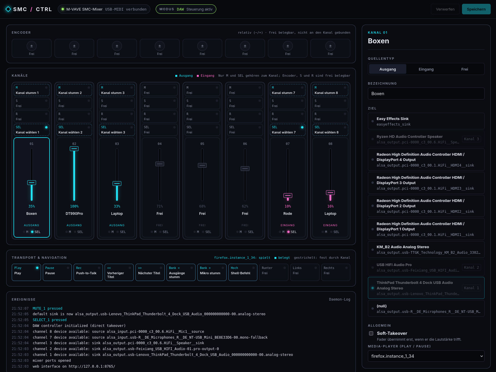
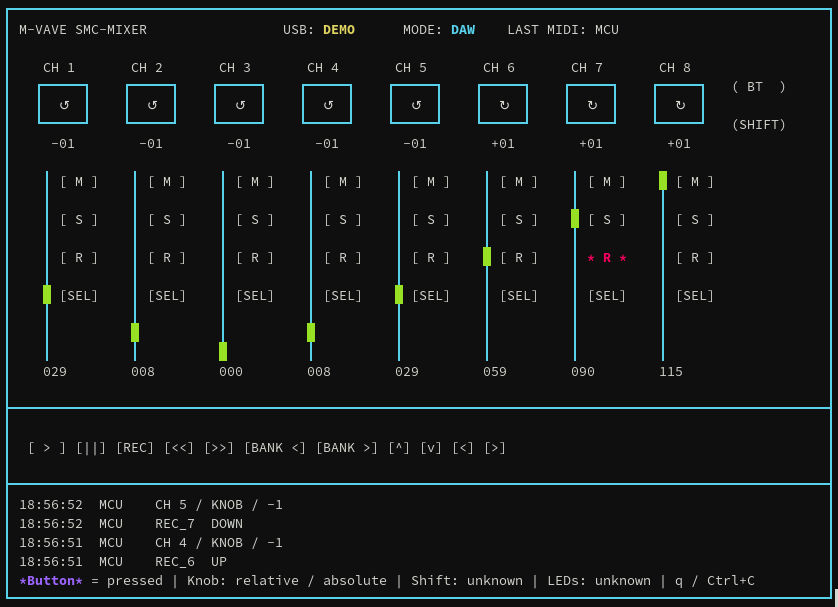

# smc-mixer

Control the M-Vave / Sinco SMC-Mixer over USB-MIDI. Use the **Linux daemon** to
turn it into a desktop audio mixer with a web interface, program it from Python,
or observe it with the read-only terminal monitor.



- **Daemon and web interface:** faders set PipeWire/PulseAudio volumes, M mutes, SELECT
  picks the default output or input, and play/pause drive an MPRIS player. Every button
  and knob can be bound to an action or shell command in the browser. Start it with
  `uv run smc-mixer-daemon run` and open <http://127.0.0.1:8765/>
  ([daemon guide](docs/daemon.md)). Buttons, knobs and faders are also published over
  [MQTT](docs/daemon.md#mqtt), which can set LEDs and mute channels.
- **Python library:** read buttons, faders and relative DAW or absolute USER knob movements,
  read the device mode and fader positions, control button LEDs and knob blinking, and
  reconnect automatically.

## Compatibility

| Requirement | Supported configuration |
|---|---|
| Python | 3.11 or newer; Python 3.12 recommended for prebuilt `python-rtmidi` wheels |
| System | Linux with ALSA |
| Device | M-Vave / Sinco SMC-Mixer |
| State reads | Verified on firmware `SMC-Mixer_011` |

Other firmware can still produce MIDI events, but its state-table addresses
are not verified. See [hardware support and limitations](docs/control.md).
Building `python-rtmidi` from source requires a C++ compiler and ALSA headers
(Arch Linux: `base-devel`, `alsa-lib`).

## Install

From this checkout:

```sh
uv sync
```

As a dependency in another project:

```sh
uv add /path/to/m-wave_smc-mixer
```

## Quick start: Python

```python
from smc_mixer import DeviceMode, SmcMixer

with SmcMixer.open() as mixer:
    print(mixer.mode)
    print(mixer.faders)
    if mixer.mode == DeviceMode.USER:
        print(mixer.user_knobs)

    for event in mixer.events():
        print(event)
```

Opening initializes supported state and polls for changes every 0.5 seconds.
Unknown values are `None`. Press Ctrl+C to stop; the context manager closes
the ports. For event handling, explicit reads and LED commands, see the
[library API guide](docs/api.md).

## Quick start: Monitor

```sh
uv run smc-mixer monitor
uv run smc-mixer monitor --demo
```

The monitor shows faders, knob values and direction, button presses, device
mode, connection status and recent events. It sends read requests without
changing LEDs or configuration. Use a UTF-8 terminal with at least **105 columns
and 33 rows**. Press **q** or **Ctrl+C** to quit.



See the [tools guide](docs/tools.md#live-monitor) for display conventions and
the other installed commands.

## Packages and documentation

The packages are installed together:

| Package | Purpose |
|---|---|
| `smc_mixer` | Device access, state, MIDI events and LED commands |
| `smc_mixer_tools` | Monitor, diagnostics, measurements and firmware tools |
| `smc_mixer_daemon` | User-session Linux audio routing, volume and media control |

The tools and daemon use the public library API. Source code lives under `src/`; no
Python wrappers are required in the repository root.

| Guide | Contents |
|---|---|
| [Library API](docs/api.md) | State, events, polling, reconnects, errors and examples |
| [Tools](docs/tools.md) | Monitor, diagnostics, guided measurements and offline firmware workflow |
| [Linux daemon](docs/daemon.md) | PipeWire/PulseAudio controls, playback routing, MPRIS and systemd user service |
| [Controls](docs/control.md) | DAW/USER mappings, LEDs, state tables and hardware limitations |
| [USB and Sinco protocol](docs/usb-midi.md) | Ports, framing, packet layout and read commands |
| [Firmware analysis](docs/firmware.md) | Firmware 013 findings, Jieli structures and PI32v2 disassembly |
| [Research archive](docs/README.md#research-archive) | Measurement history and manufacturer-tool investigations |

## Development

```sh
uv sync
uv run pytest
uv run ruff check .
uv run ruff format --check .
uv run mypy
```

Tests use fake MIDI ports and run without a mixer. Local firmware, toolchains
and generated analysis files are kept outside Git; see the
[documentation index](docs/README.md).
